<div align="center">


**Dotfiles personales**
*by [TheOffSecGirl](https://github.com/theoffsecgirl)*

> 🇬🇧 [English version](README.md)

</div>

## Qué es esto

Un setup de dotfiles orientado a macOS y terminal, gestionado con [GNU Stow](https://www.gnu.org/software/stow/) y un `Makefile`. Cubre configuración de shell (zsh), Neovim, tmux, Ghostty y git.

El pipeline de bug bounty / pentesting (scripts de recon, containers, plantilla de workspace de hunting) vivía antes en este repo. Se ha migrado a un repo separado y privado. Este repo ya no lo contiene ni depende de él.

## Instalación

> ⚠️ **¿Mac recién formateada o nueva (sin Homebrew)?** Salta directamente a `make macos` más abajo — `make install` solo fallará con `stow: No such file or directory` porque Homebrew y Stow aún no están instalados.

```bash
git clone git@github.com:theoffsecgirl/dotfiles.git ~/.dotfiles
cd ~/.dotfiles
make install
exec zsh
```

`make install` ejecuta `stow -t $HOME runcom config bin` y `brew bundle --file=install/Brewfile`. Úsalo solo si Homebrew ya está instalado.

Para simular los cambios de Stow sin aplicarlos:

```bash
stow -n -v -t "$HOME" runcom config bin
```

En una Mac nueva, `make macos` instala Homebrew por sí mismo y luego delega en `make install` — **usa este primero en una máquina nueva**:

```bash
make macos
```

La configuración específica de cada máquina vive en `~/.config/zsh/local.zsh`, que no se versiona.

## Targets del Makefile

```bash
make help     # lista todos los targets
make install  # stow runcom/config/bin + brew bundle
make macos    # bootstrap de una Mac nueva (Homebrew + make install)
make test     # corre la suite de tests con bats
make update   # brew update/upgrade + re-aplica stow
make link     # solo re-aplica los symlinks de stow (tras un git pull)
make clean    # elimina los symlinks creados por stow
make edit     # abre el repo en $EDITOR
```

## Comandos útiles

```bash
dotfiles-ref   # cheatsheet interactivo de este setup de dotfiles
tips           # cheatsheet interactivo de aliases/funciones de shell
tmux-popup     # terminal flotante en tmux (popup)
tmux-sessionizer  # selector rápido de proyectos/sesiones con fzf
theme          # cambiar el tema de la terminal (ver "Temas")

mkproject nombre dir1,dir2,dir3  # crear carpeta de proyecto con subcarpetas
ezsh           # abrir el directorio zsh de los dotfiles en $EDITOR
reloadzsh      # relanzar una sesión de zsh limpia
showaliases    # listar todos los aliases activos
extra archivo.tar.gz  # descomprimir cualquier formato (tar/zip/rar/7z/gz/bz2)
gotodir nombre # cd al primer directorio que matchee un fragmento de nombre
quickvenv      # crear y activar un .venv local
updateall      # update_system (paquetes del SO) + pip + plugins de nvim
```

## Temas

La terminal tiene selector de temas. Un solo comando cambia a la vez **Ghostty, el prompt de Starship, fzf, tmux, fastfetch y Neovim**, y cada tema trae su propio dibujo en fastfetch (calabaza, pulpo, murciélago, invasor espacial…):

```bash
theme                    # selector con fzf y vista previa de cada paleta
theme trick-or-treat     # aplicar un tema directamente
theme list               # ver todos (★ = el actual)
theme preview maple-forest
theme random             # sorpresa
theme reset              # volver a neon-fuchsia
```

| Tema | Vibe |
|---|---|
| `neon-fuchsia` | Cyber neón: fucsia, rosa y cian (el original) |
| `pumpkin-spice` 🍂 | Otoño cozy: calabaza, miel y salvia sobre marrón café |
| `trick-or-treat` 🎃 | Halloween clásico: calabaza, candy corn, verde baba y morado bruja |
| `maple-forest` 🍁 | Bosque otoñal: óxido, rojo arce, dorado y musgo |
| `witching-hour` 🦇 | Noche de brujas: luna naranja y violeta sobre azul medianoche |
| `matrix-terminal` 👾 | Hacker CRT: verde fósforo, lima y ámbar sobre negro |
| `deep-sea` 🐙 | Fondo marino: turquesa bioluminiscente, medusa y coral |
| `sakura-bloom` 🌸 | Pastel japonés: rosa cerezo, lila y verde hoja |
| `arctic-frost` 🧊 | Ártico: azul hielo, aurora turquesa y violeta |
| `synthwave-sunset` 🌆 | Retro 80s: sol naranja, rosa neón y amarillo sobre morado |
| `paper-latte` ☕ | **Claro**: papel crema, terracota y mostaza (para el día) |
| `mono-ink` 🖤 | Minimalista: grises de tinta con un único acento rojo |
| `amber-crt` 📟 | Retro monocromo: fósforo ámbar sobre negro, estilo VT220 |
| `high-contrast` ⚡ | Máxima legibilidad: negro puro, blanco y primarios intensos |
| `lava-core` 🌋 | Volcánico: magma rojo, naranja incandescente y azufre |
| `desert-dune` 🐪 | Desierto: arena, terracota, turquesa de oasis y cielo malva |
| `mint-breeze` 🌿 | **Claro**: blanco menta, verde bosque y azul petróleo |
| `cotton-candy` 🍬 | **Claro**: rosa chicle, azul algodón y lila |
| `soft-concrete` 🤍 | Minimal soft: piedra, topo, óxido suave y cristal gris azulado |

### Galería

<table>
<tr><td align="center">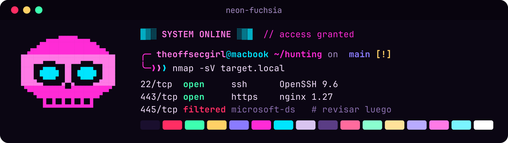<br><code>neon-fuchsia</code></td><td align="center">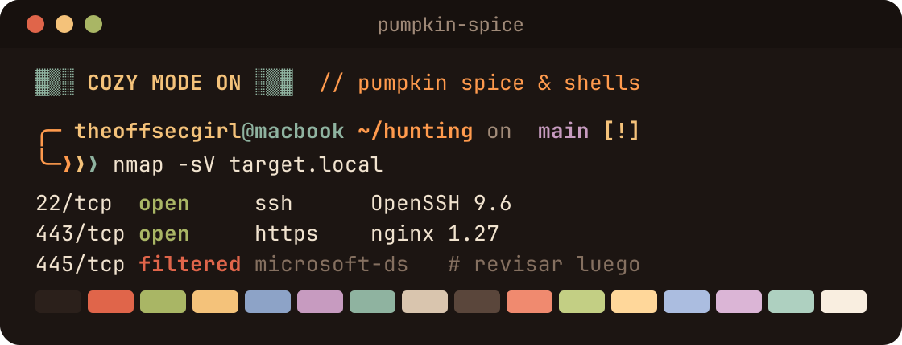<br><code>pumpkin-spice</code></td></tr>
<tr><td align="center">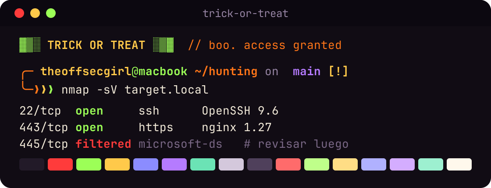<br><code>trick-or-treat</code></td><td align="center">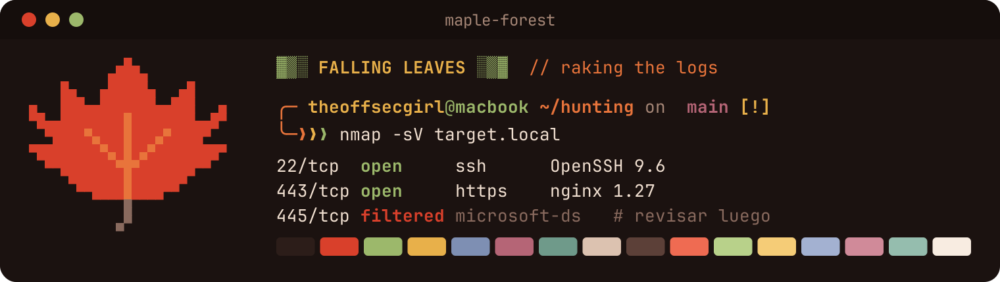<br><code>maple-forest</code></td></tr>
<tr><td align="center">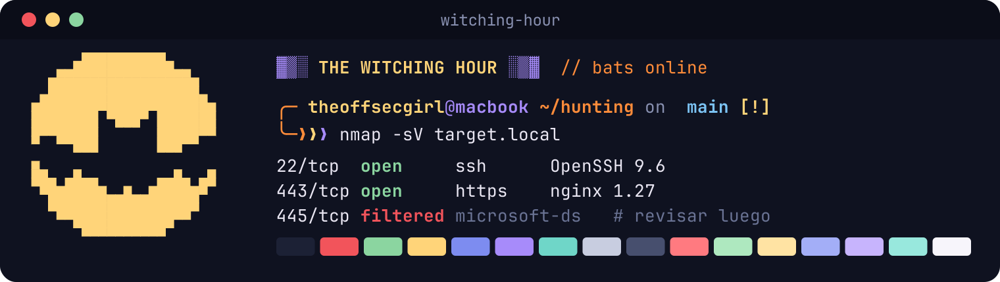<br><code>witching-hour</code></td><td align="center">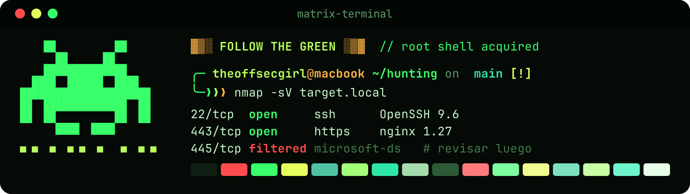<br><code>matrix-terminal</code></td></tr>
<tr><td align="center">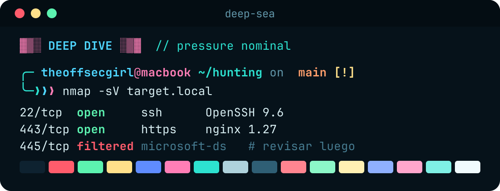<br><code>deep-sea</code></td><td align="center">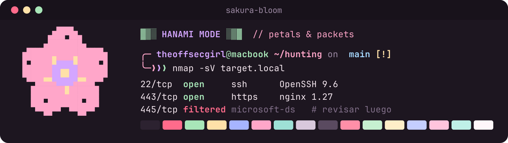<br><code>sakura-bloom</code></td></tr>
<tr><td align="center">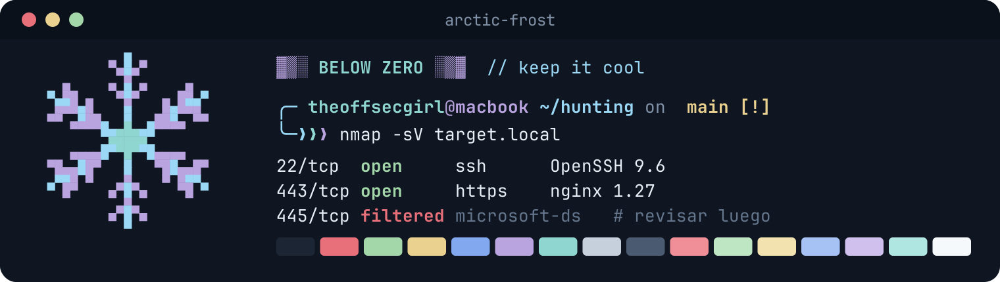<br><code>arctic-frost</code></td><td align="center">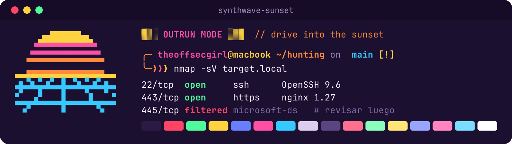<br><code>synthwave-sunset</code></td></tr>
<tr><td align="center">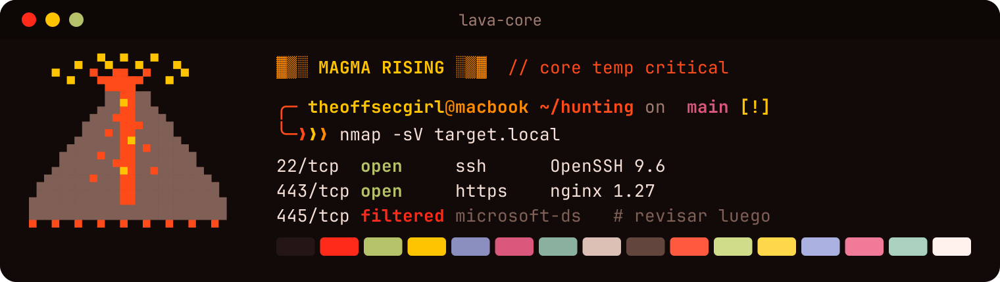<br><code>lava-core</code></td><td align="center">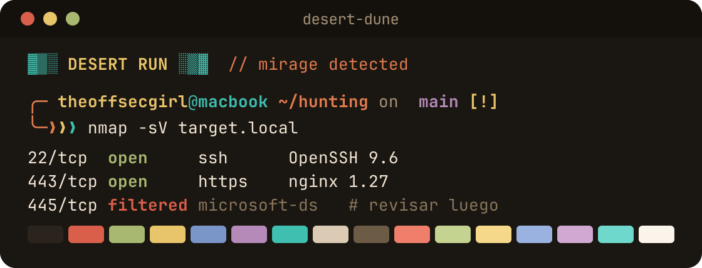<br><code>desert-dune</code></td></tr>
<tr><td align="center">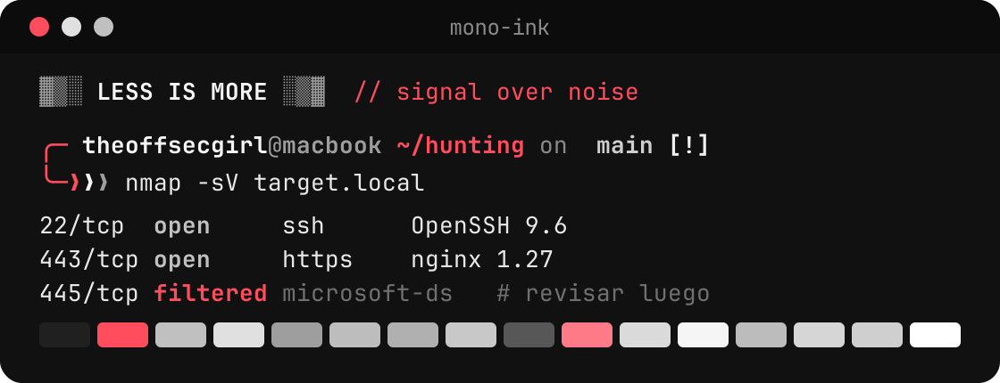<br><code>mono-ink</code></td><td align="center">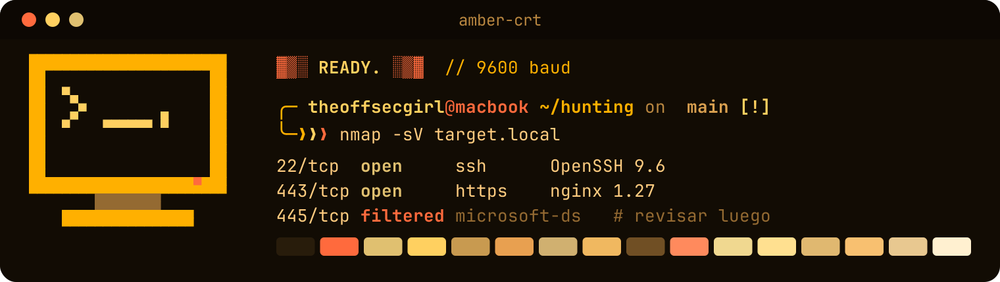<br><code>amber-crt</code></td></tr>
<tr><td align="center">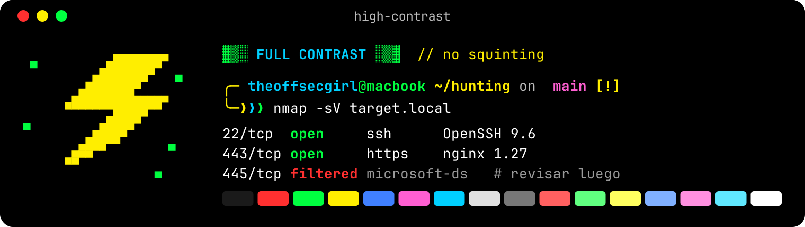<br><code>high-contrast</code></td><td align="center">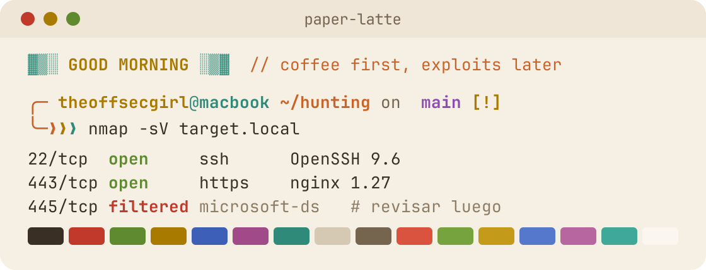<br><code>paper-latte</code></td></tr>
<tr><td align="center">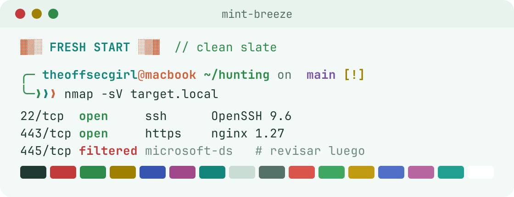<br><code>mint-breeze</code></td><td align="center">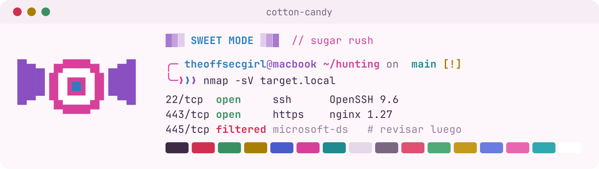<br><code>cotton-candy</code></td></tr>
<tr><td align="center">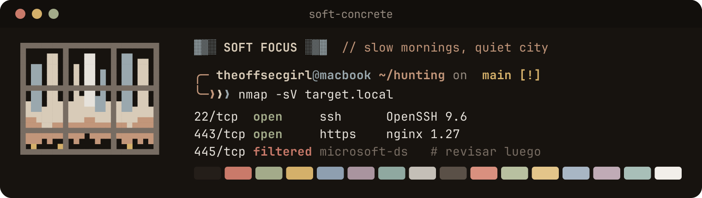<br><code>soft-concrete</code></td><td></td></tr>
</table>

La terminal actual cambia al momento; en el resto de pestañas de Ghostty pulsa `Cmd+Shift+,` y Neovim lo coge al reabrirlo. La elección se guarda en `~/.local/state/theme/` (fuera del repo).

**Crear un tema nuevo:** copia cualquier `config/.config/themes/*.theme`, cambia los colores y ya aparece en `theme list`. Para uno claro, añade `THEME_MODE="light"` y `bright="<color de texto más oscuro>"` (mira `paper-latte`). Su dibujo va en `config/.config/fastfetch/logos/<tema>.txt`: una cuadrícula donde cada letra es un color del tema (`P` principal, `S` secundario, `A` acento, `E` extra, `T` texto, `R` rojo, `G` verde, `Y` amarillo, `M` gris, `D` fondo, `W` blanco, `.` vacío). Para su imagen de la galería: `python3 docs/themes/gen-previews.py`.

## Tests

```bash
cd ~/.dotfiles
make test
```

## Estructura

```text
~/.dotfiles/
├── runcom/   # .zshrc, .zprofile
├── config/   # zsh/, nvim/, tmux/, ghostty/, git/
├── install/  # Brewfile
├── macos/    # bootstrap-macos.sh
├── bin/      # utilidades genéricas (tmux-popup, tmux-sessionizer)
├── test/
├── docs/
└── Makefile
```

Gestionado con GNU Stow.

## Licencia

MIT
