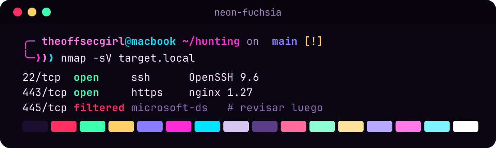
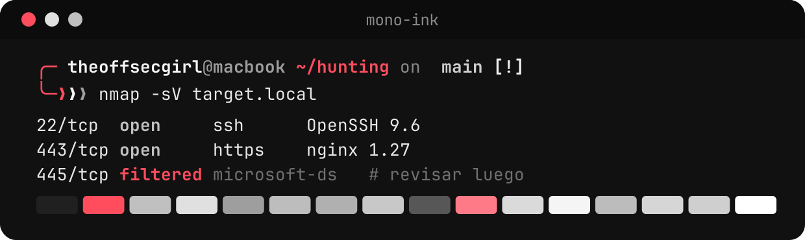
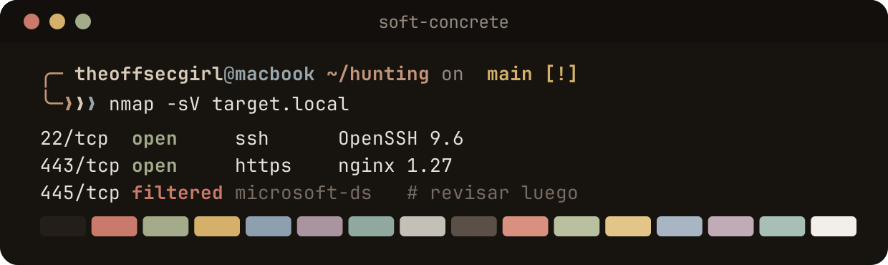
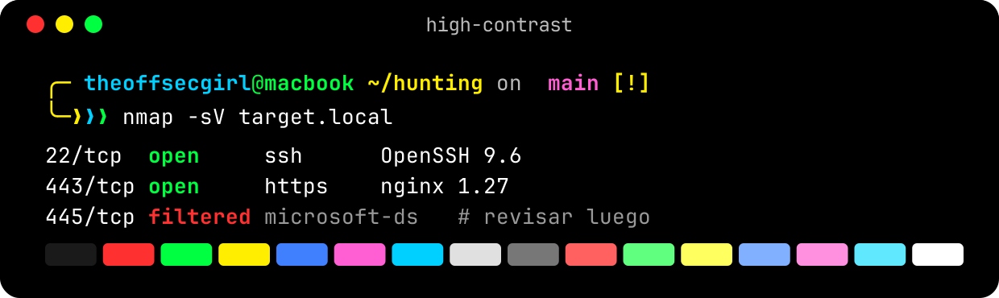
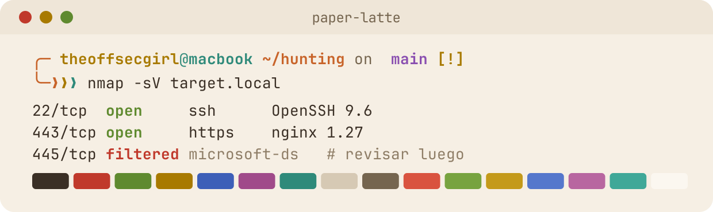

<div align="center">


**Personal dotfiles**
*by [TheOffSecGirl](https://github.com/theoffsecgirl)*

> 🇪🇸 [Versión en español](README.es.md)

</div>

## What this is

A macOS-first, terminal-centric dotfiles setup managed with [GNU Stow](https://www.gnu.org/software/stow/) and a `Makefile`. It covers shell configuration (zsh), Neovim, tmux, Ghostty and git.

The bug bounty / pentesting pipeline (recon scripts, containers, hunting workspace template) used to live in this repo. It has since moved to a separate, private repo. This repo no longer contains or depends on it.

## Install

> ⚠️ **Brand-new / freshly reinstalled Mac (no Homebrew yet)?** Skip straight to `make macos` below — `make install` alone will fail with `stow: No such file or directory` because Homebrew and Stow aren't installed yet.

```bash
git clone git@github.com:theoffsecgirl/dotfiles.git ~/.dotfiles
cd ~/.dotfiles
make install
exec zsh
```

`make install` runs `stow -t $HOME runcom config bin` and `brew bundle --file=install/Brewfile`. Use this only if Homebrew is already installed.

Preview the Stow changes without applying them:

```bash
stow -n -v -t "$HOME" runcom config bin
```

On a brand-new Mac, `make macos` bootstraps Homebrew itself and then delegates to `make install` — **use this one first on a fresh machine**:

```bash
make macos
```

Machine-specific overrides belong in `~/.config/zsh/local.zsh`, which is not versioned.

## Makefile targets

```bash
make help     # lists all targets
make install  # stow runcom/config/bin + brew bundle
make macos    # bootstrap a fresh macOS machine (Homebrew + make install)
make test     # run the bats test suite
make update   # brew update/upgrade + re-stow
make link     # re-apply stow symlinks only (after a git pull)
make clean    # remove the symlinks created by stow
make edit     # open the repo in $EDITOR
```

## Useful commands

```bash
dotfiles-ref   # interactive cheatsheet for this dotfiles setup
tips           # interactive cheatsheet for shell aliases/functions
tmux-popup     # floating tmux popup terminal
tmux-sessionizer  # fuzzy project/session switcher
theme          # switch the terminal theme (see "Themes")

mkproject name dir1,dir2,dir3  # create a project folder with subfolders
ezsh           # open the dotfiles zsh config directory in $EDITOR
reloadzsh      # exec a fresh zsh session
showaliases    # list all active aliases
extra file.tar.gz  # extract any archive format (tar/zip/rar/7z/gz/bz2)
gotodir name   # cd into the first directory matching a name fragment
quickvenv      # create + activate a local .venv
updateall      # update_system (OS packages) + pip + nvim plugins
```

## Themes

The terminal has a theme switcher. One command recolors **Ghostty, the Starship prompt, fzf, tmux, fastfetch and Neovim** together. Minimal look: no pixel-art, emojis or taglines; fastfetch shows just the info:

```bash
theme                    # fzf picker with a live palette preview
theme paper-latte        # apply a theme directly
theme list               # list all (★ = current)
theme preview mono-ink
theme random
theme reset              # back to neon-fuchsia
```

| Theme | Vibe |
|---|---|
| `neon-fuchsia` | Cyber neon: fuchsia, pink and cyan (brand theme, default) |
| `mono-ink` | Minimal: ink greys with a single red accent |
| `soft-concrete` | Soft minimal: stone, taupe, soft rust and blue-grey |
| `high-contrast` | Maximum legibility: pure black, white and bold primaries |
| `paper-latte` | **Light**: cream paper, terracotta and mustard (daytime) |

### Gallery

<table>
<tr><td align="center"><br><code>neon-fuchsia</code></td><td align="center"><br><code>mono-ink</code></td></tr>
<tr><td align="center"><br><code>soft-concrete</code></td><td align="center"><br><code>high-contrast</code></td></tr>
<tr><td align="center"><br><code>paper-latte</code></td><td></td></tr>
</table>

The current terminal changes instantly; other Ghostty tabs pick it up with `Cmd+Shift+,`, Neovim on next launch. The choice lives in `~/.local/state/theme/` (outside the repo). To add a theme, copy any `config/.config/themes/*.theme` and edit the colors; regenerate the gallery images with `python3 docs/themes/gen-previews.py`.

## Tests

```bash
cd ~/.dotfiles
make test
```

## Structure

```text
~/.dotfiles/
├── runcom/   # .zshrc, .zprofile
├── config/   # zsh/, nvim/, tmux/, ghostty/, git/
├── install/  # Brewfile
├── macos/    # bootstrap-macos.sh
├── bin/      # generic utilities (tmux-popup, tmux-sessionizer)
├── test/
├── docs/
└── Makefile
```

Managed with GNU Stow.

## License

MIT
